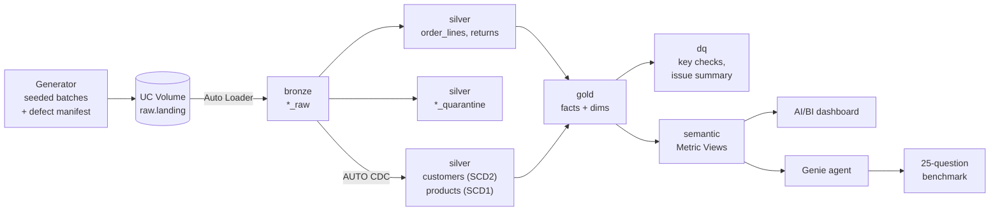

# Governed Retail AI/BI Lakehouse

**Databricks · PySpark · Lakeflow Spark Declarative Pipelines (formerly DLT) · Unity Catalog · Metric Views · AI/BI Dashboards · Genie**

A lakehouse for a fictional online retailer, built on Databricks Free Edition:

- Raw order, return, customer and product feeds are loaded **incrementally** into Bronze, Silver and Gold.
- Bad records are **quarantined** with the rule they broke.
- KPIs are defined **once** as Unity Catalog Metric Views. A dashboard and a Genie agent use those definitions.
- Genie is **evaluated** on a fixed set of 25 business questions.

The data is synthetic and seeded. The generator records every defect it injects, so the pipeline's data-quality
results can be checked against ground truth instead of eyeballed.

## Architecture



| Layer | What happens | Code |
|---|---|---|
| Landing | 1-year backfill + 14 daily batches of JSON/CSV files. Batch 7 re-sends batch 6's orders. | `generator/` |
| Bronze | Auto Loader streaming tables. Fixed schemas, rescued-data column, source file and load time on every row. | `pipelines/transformations/bronze.py` |
| Silver | Explode orders into lines; validate with `expect_all_or_drop` in an append-only stream; same rules feed quarantine tables; a materialized view removes exact re-sends by content hash (first arrival kept); AUTO CDC for customer history (SCD2) and products (SCD1). | `silver.py` |
| Gold | Star schema as materialized views: point-in-time customer join, unknown members instead of dropped rows, returns attached to their order line, column comments from code. | `gold.py`, `utilities/catalog_docs.py` |
| DQ | `expect_or_fail` key checks; issue summary by feed, batch and rule. | `dq_checks.py` |
| Semantic | Metric Views for sales (by order date) and returns (by return date), with synonyms for Genie. | `semantic/` |
| Governance | Least-privilege grants by layer, no PII in gold, email masking, tags, lineage. | `governance/` |

Details: [data model](docs/data_model.md) · [data-quality rules](docs/dq_rules.md) ·
[metric definitions](docs/metric_definitions.md) · [Genie evaluation](docs/evaluation_report.md)

## Evidence

| Claim | Proof |
|---|---|
| Incremental | : a rerun with no new files writes 0 rows |
| Quarantine catches exactly the injected defects |  |
| One KPI definition |  |
| Lineage from KPI to file |  |
| Least privilege |  |
| Dashboard |  |
| Genie benchmark |  |

## Results

TODO, after the Databricks runs:

- Data quality: 3,105 of 343,151 order lines and 155 of 31,730 returns quarantined, matching the injected defects
  exactly. 2,757 duplicate lines removed, including a fully re-sent file. 983 order lines with unknown products
  kept and flagged instead of dropped.
- Genie (holdout accuracy, strict / reviewed): tables only TODO → metric views TODO → after fixes TODO.
- The errors that mattered: TODO.

## Lessons learned

TODO, in your own words. Prompts:
- What surprised you in the Genie failures?
- What would have gone wrong without the manifest?
- What did Free Edition make harder, and how did you work around it?
- What would you do differently with a second week?

## Run it

**Locally** (Python 3.11+ and Java 17): the generator, the transforms and the whole pipeline in batch mode,
reconciled against the manifests.

```bash
python3 -m venv .venv && .venv/bin/pip install -r requirements-dev.txt
.venv/bin/python -m pytest
```

**On Databricks Free Edition**: follow [docs/RUNBOOK.md](docs/RUNBOOK.md). It takes about a day, including the
dashboard and the Genie runs.

## Repository

```
generator/      seeded synthetic data, batch slicing, defect manifest
pipelines/      Lakeflow pipeline: transformations/ (bronze, silver, gold, dq) and utilities/ (pure PySpark)
notebooks/      smoke test, setup, landing, incremental proof, validation
semantic/       Metric Views
governance/     grants, masking, tags
dashboards/     the AI/BI dashboard as code (retail_kpis.lvdash.json), dataset SQL, build guide
genie/          benchmark questions, ground-truth SQL, expected answers, run sheets, evaluation protocol
tools/          local pipeline runner, benchmark export, run scoring
tests/          generator, transforms, metric views, dashboard references, end-to-end reconciliation, benchmarks
docs/           runbook, data model, DQ rules, metric definitions, evaluation report
```
