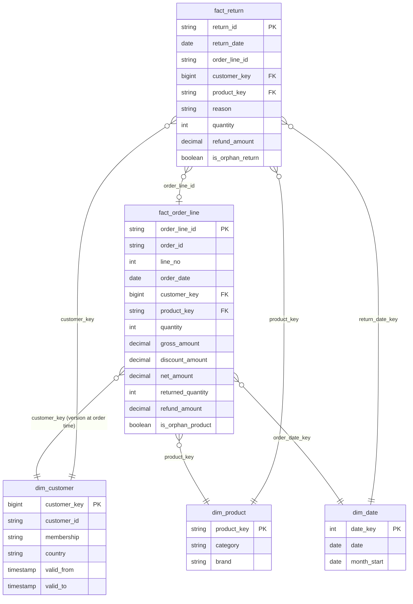

# Data model

## Layers

| Layer | Tables | Grain | Built by |
|---|---|---|---|
| Landing | `raw.landing` volume: `<entity>/<batch_id>/*`, `_manifest/<batch_id>.json` | files | generator |
| Bronze | `orders_raw`, `returns_raw`, `customers_cdc_raw`, `products_cdc_raw` | one row per record received | Auto Loader streaming tables |
| Silver | `order_lines`, `returns` | one row per valid order line / return, exact copies removed | streaming tables |
| Silver | `order_lines_quarantine`, `returns_quarantine` | one row per bad record received, with `failed_rules` | streaming tables |
| Silver | `customers` (SCD2), `products` (SCD1) | one row per customer version / product | AUTO CDC |
| Gold | `dim_date`, `dim_customer`, `dim_product`, `fact_order_line`, `fact_return` | see below | materialized views |
| Semantic | `sales_metrics`, `returns_metrics` | metric views | SQL |
| DQ | `*_key_check`, `issue_summary` | one row per check / per issue and batch | materialized views |

## Star schema

## Design decisions

**Two facts, two date bases.** `fact_order_line` answers "what did we sell, and how much of it came back?" by
**order date**. `fact_return` answers "what was returned and refunded in this period?" by **return date**. Return
rate needs units sold as its denominator, so it lives on the order-line fact. Refunds paid in a period live on the
return fact. The two refund totals for "August" differ by design (B15 in the benchmark tests exactly this).

**Returns attached to the order line.** `fact_order_line.returned_quantity` and `refund_amount` aggregate every
return of that line. A return rate is then a ratio of two sums on one table, with no join that could fan out.

**Customer history (SCD2) with a point-in-time join.** `dim_customer` has one row per version of a customer
(membership upgrades, moves). The fact stores the `customer_key` of the version that was valid when the order was
placed, so "sales by membership tier" means the tier at the time, not today's. Joining on `customer_id` instead
would match every version and double-count (B22).

**Products as SCD1.** A product's list price changes, but each order line carries the price actually charged, so
history on the product isn't needed for revenue. The dimension keeps the current attributes.

**Unknown members instead of dropped rows.** Order lines whose product isn't in the catalogue get
`product_key = 'UNKNOWN'` (category "Unknown"). Returns that point to no known order line get the unknown product
and customer (`-1`). Revenue and refunds are never lost to an inner join, and both are flagged for follow-up.

**No PII in gold.** `dim_customer` has no name or email. Those stay in `silver.customers`, which analysts can't read.

**Surrogate keys.** `customer_key = xxhash64(customer_id, valid_from)`: stable across refreshes without a
sequence. Uniqueness is enforced by `dq.dim_customer_key_check` (`expect_or_fail`).
